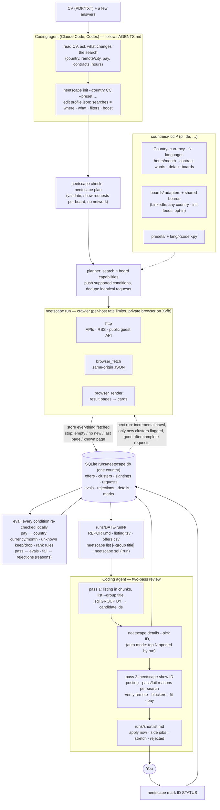

# neetscape

neetscape is a job offer radar for the job boards of one country at a time (Poland and Germany so far; adding a
country is a directory, see [Countries](#countries)), with opt-in international feeds. You describe what to
look for as a JSON profile of composable searches; neetscape crawls the boards, stores every offer
in SQLite, filters and ranks them locally and writes a listing and a report.

It is designed to be operated by a coding agent (Claude Code, Codex or similar) that follows
[`AGENTS.md`](AGENTS.md): the agent writes the profile from your CV, runs the crawl, reads the
postings and gives you a shortlist. neetscape itself makes no LLM calls and needs no API keys.

## Quick start with an agent

```
git clone <this repo> && cd neetscape
claude          # or any agent that reads AGENTS.md / CLAUDE.md
> Here is my CV: ~/cv.pdf. Find me remote work; side jobs welcome.
```

## Manual quick start

Requirements: Python 3.10+, a Chromium-family browser (chromium, google-chrome, brave) and,
preferably, `Xvfb`.

```
python3 -m venv .venv && . .venv/bin/activate && pip install -e .

neetscape init --preset focused --preset side   # writes profile.json; edit it (--country de for Germany)
neetscape check                                 # validate
neetscape plan                                  # what goes to which board (no network)
neetscape run                                   # crawl, evaluate, write the report
neetscape list --new --limit 50                 # offers new in this run
neetscape details --pick 12,40                  # fetch full postings for chosen ids
neetscape show 12                               # offer, per-search verdict, posting text
neetscape mark 12 applied --note "sent CV"      # track your decisions
```

Commands at a glance (`neetscape --help` for all flags):

| Group | Commands |
|---|---|
| Setup | `init [--country CC] [--preset P ...]`, `check`, `plan`, `boards [--country CC]`, `probe BOARD [--keyword K] [--save-fixture PATH]` |
| Run | `run [--resume] [--full] [--limit-pages N] [--boards a,b] [--record DIR]`; single steps `crawl`, `eval`, `report` |
| Review | `list [--search ID] [--new] [--group title] [--where SQL] [--limit N] [--format tsv\|md\|json]`, `details --pick IDS \| --pick-file F \| --top N`, `show ID`, `sql "SELECT ... :run"` |
| Tracking | `mark ID\|URL STATUS [--note TEXT]`, `tracked` |

Common options: `--profile` (default `profile.json`), `--out` (data directory, default `runs`),
`--run` (run id, default latest). Mark statuses: `shortlisted applied interview offer rejected
ignored`; `rejected` and `ignored` offers are hidden from later listings.

## Presets

`neetscape init` writes `profile.json` from one or more presets (`--preset` is repeatable, default
`focused`; `--country` defaults to `pl`). With several presets the searches are concatenated; other
settings come from the first preset that sets them. A country's own presets
(`neetscape/countries/<cc>/presets/`) take precedence over the shared ones in
`neetscape/profile/presets/`, which fill the rest. `init` refuses to overwrite an existing `profile.json`.

| Preset | Searches | Review mode | Poland (`pl`) | Germany (`de`) |
|---|---|---|---|---|
| `focused` | one remote search with phrases, title include/exclude, levels excluded, monthly pay floor; rank rules and tags (an example to adapt) | `auto` (opens the top N postings during `run`) | shared (Polish/English phrases, PLN floor) | shared: rewrite phrases and the floor in EUR |
| `broad` | every remote offer, no phrases | `listing` | shared | own |
| `local` | every offer within a radius of a city | `listing` | shared (Kraków, 30 km) | own (Berlin, 25 km) |
| `side` | remote part-time / flexible work or side contracts, hourly pay floor, junk filter, score boost | `listing` | shared (mandate / specific task / freelance, 30 PLN/h) | own (Minijob / Werkstudent / freelance, 15 €/h) |

## Search profile

A profile is the union of its searches: conditions inside a search are ANDed, an offer passes the
profile if it passes any search. `defaults` are merged into every search. Rank rules only order
results; they never drop anything.

```json
{
  "version": 2,
  "country": "pl",
  "boards": ["pl"],
  "defaults": {"max_age_days": 30, "unknown": "keep"},
  "searches": [
    {"id": "main", "where": "remote", "what": ["automation", "n8n", "helpdesk"],
     "keywords_for": {"linkedin": ["AI automation", "IT support"]},
     "title_exclude": ["senior|lead|architect"], "pay": {"min": 8000, "per": "month"}},
    {"id": "krk", "where": {"city": "Kraków", "radius_km": 30, "or_remote": true}, "what": "all",
     "contracts": ["employment", "b2b"]},
    {"id": "side", "where": "remote", "what": "all", "worktime": ["part_time", "flexible"],
     "contracts": ["mandate", "specific_task", "freelance"], "pay": {"min": 40, "per": "hour"}, "boost": 3}
  ],
  "rank": {"rules": [{"pattern": "n8n|zapier", "weight": 3}], "sort": ["score", "new", "pay"]},
  "review": {"mode": "listing"}
}
```

Search fields:

| Field | Meaning |
|---|---|
| `where` | `"remote"` (default), `"anywhere"`, `{"city", "radius_km", "or_remote", "country"}`, or `{"remote": true, "country": "de"}` (search another country's boards; they must be in `boards`) |
| `what` | `"all"` or a list of phrases; `keywords_for` overrides phrases per board |
| `worktime`, `contracts` | allowed values; an offer passes if its work time **or** one of its contracts is allowed. Contracts: `employment` (old name `uop` still accepted), `b2b`, `mandate`, `specific_task`, `internship`, `freelance`, `mini_job`, `working_student`, `temp_agency`, `other`; local words of the profile's country (`minijob`, `werkstudent`) are accepted too |
| `levels_exclude` | `intern junior mid senior lead manager unknown` |
| `pay` | `{"min", "per": "month"\|"hour", "required"}`; amounts are in the profile country's currency (PLN, EUR), compared against the top of the offer's range |
| `max_age_days` | drop offers published earlier |
| `title_include`, `title_exclude`, `text_exclude`, `category_include` | case-insensitive Python regexes |
| `unknown` | `keep` (default) or `drop` offers whose filtered field (mode, pay, work time, date, location) is unknown |
| `boost` | score added to offers passing this search |

Top-level keys: `country` (`pl` default, `de`), `boards` (board names or groups: a country code, `intl`, `all`;
default: the boards of the profile's country and of every country a search targets), `candidate` (free-form notes
for the reviewing agent, ignored by the tool), `rank` (`rules`, `tags`, `sort`), `review` (`mode`
`auto`/`listing`, `details_top`, `min_score`), `politeness` (`min_interval_s` per host, `retries`),
`fx` (units of the country's currency per unit of another currency; the country sets defaults). The full definition is
[`neetscape/profile/schema.json`](neetscape/profile/schema.json).

## How it works

The same diagram as [`docs/flow.mmd`](docs/flow.mmd) (rendered: [`docs/flow.png`](docs/flow.png)).



1. **Plan.** Each board declares capabilities (keyword search, remote filter, city/radius,
   part-time filter, newest-first sort, page size, transport). The planner turns every search
   into requests for every board, pushing only the conditions a board supports, and fetches
   identical requests once. A board that cannot serve a search (e.g. no city search, or a listing
   too large without keywords) is skipped with a warning shown by `neetscape plan`.
2. **Crawl.** Boards run concurrently, requests within a board sequentially, all through a
   per-host rate limiter. Transports: `http` (APIs, RSS), `browser_fetch` (same-origin requests
   from a tab on the board) and `browser_render` (rendered result pages). The browser is a private
   Chromium instance with its own profile on CDP port 9334, on `Xvfb` when available, otherwise
   headless.
3. **Store everything, filter on read.** Every fetched offer is stored. A pushed filter is used
   as evidence (an offer from a remote-filtered request with no mode becomes `remote`), and then
   every condition is re-checked locally, so capabilities affect crawl cost, never results, and a
   profile change does not require a new crawl (`neetscape eval` + `neetscape report`).
4. **Deduplicate.** The same job on several boards forms one cluster (normalised title and
   company); an offer is *new* when its cluster first appeared in this run.
5. **Evaluate.** Every stored offer is checked against every search; passing offers go to `evals`
   with a score, failing ones to `rejections` with the reasons (`mode onsite; title excluded`).
6. **Review in two passes.** Pass 1 reads the listing (in chunks, grouped by title, sliced with SQL)
   and picks candidate ids; `neetscape details --pick` fetches their postings. Pass 2 reads each
   posting with `neetscape show ID` and decides. In `auto` mode `run` already opens the top
   `details_top` postings; in `listing` mode it stops at `listing.tsv`.

Incremental crawling: on boards sorted newest-first a request stops at a full page of offers
already known from earlier runs (`--full` disables this). A request is *complete* when it ends on
an empty, short or no-new-offers page; offers are marked gone only after a complete request with
the same parameters no longer returns them, or when their posting returns 404/410. `run --resume`
continues an interrupted run, skipping requests that already finished.

## Data

Everything lives in `runs/neetscape.db` (SQLite, schema versioned with `PRAGMA user_version`):

| Table | Content |
|---|---|
| `runs` | one row per run: time, status, profile snapshot |
| `requests` | every board request: parameters, pushed conditions, pages, offers found, complete flag, stop reason, error |
| `offers` | one row per board offer: normalised fields, `pay_min`/`pay_max` per month in the profile country's currency, first/last seen run, `gone_at`, `cluster_id` |
| `clusters` | cross-board duplicates; `first_seen_run` drives the *new* flag |
| `sightings` | which request saw which offer on which page |
| `evals` | offers that pass a search in a run, with score, matched rank rules and tags |
| `rejections` | offers that fail a search in a run, with the reasons joined by `; ` (also shown by `neetscape show ID`) |
| `details` | fetched posting text, JSON-LD and hints (remote, years, degree, languages) |
| `marks` | append-only decisions; view `tracked` holds the latest per URL |

Each run also writes `runs/<date>-run<N>/` with `REPORT.md` (board stats, top offers per search,
tracked offers, opened postings), `listing.tsv` and `offers.csv`.

`neetscape list` prints the same listing (one row per job, duplicates across boards merged) with
filters: `--search ID`, `--new`, `--where "o.pay_max > 10000"` (an SQL condition on `offers o`),
`--limit N`, `--format tsv|md|json`. `--group title` collapses it to one row per normalised title
with the number of offers, companies, boards, new offers, best pay and the offer ids:

```
neetscape list --group title --limit 40
neetscape list --search side --new --format md
```

`neetscape sql` opens the database read-only. The parameter `:run` is bound to `--run N` or, by
default, the latest run:

```
# why offers were rejected in this run
neetscape sql "SELECT reasons, COUNT(*) n FROM rejections WHERE run_id = :run GROUP BY 1 ORDER BY n DESC"

# offers passing in the run, per search and board
neetscape sql "SELECT e.search_id, o.board, COUNT(*) FROM evals e JOIN offers o ON o.id = e.offer_id
              WHERE e.run_id = :run GROUP BY 1, 2 ORDER BY 3 DESC"

# board health of the run
neetscape sql "SELECT board, COUNT(*) req, SUM(pages), SUM(found), SUM(complete), SUM(error != '')
              FROM requests WHERE run_id = :run GROUP BY board"

# best-paid remote offers still listed
neetscape sql "SELECT id, title, company, pay_max, url FROM offers
              WHERE mode = 'remote' AND gone_at IS NULL ORDER BY pay_max DESC LIMIT 20"
```

## Boards

`neetscape boards` prints the live capability table: country (`pl`, `de`, `any` for
boards serving every country, `intl`), transport, and
whether the board supports keyword search, a remote filter (`filter`, `always` for remote-only
boards, or `no`), city search, a part-time filter, newest-first sorting, and its page limit.
Poland: justjoin.it, rocketjobs.pl, pracuj.pl, nofluffjobs, Indeed, theprotocol.it, bulldogjob,
solid.jobs, useme and OLX. Germany: Arbeitnow (API) and the Bundesagentur für Arbeit Jobsuche (API).
Both: LinkedIn (public guest search). remoteok and We Work Remotely are international and opt-in
(`"boards": ["pl", "intl"]`). `neetscape boards --country de` shows only the boards serving
Germany (its own plus LinkedIn).

`neetscape probe BOARD [--keyword K]` fetches one page from a board and shows how well each field
is filled, which is the first thing to check when a board returns nothing; `--save-fixture PATH`
also writes the raw page, ready to be added to `tests/fixtures/<cc>/` (`tests/fixtures/shared/` for LinkedIn and the feeds).

Adapters live in `neetscape/countries/<cc>/boards/` (one module per board) and, for the shared boards
(LinkedIn, international feeds), in `neetscape/boards/`, next to the code all adapters use (`base`, `fetch`,
`pages`). A board declares `Caps`, turns a search into `Request`s,
builds page URLs and parses raw pages into offers with a pure `parse()` function tested on
recorded fixtures. [CONTRIBUTING.md](CONTRIBUTING.md) explains how to add or fix one.

## Countries

A country is a package `neetscape/countries/<cc>/`: `__init__.py` defines a `Country` (currency and
exchange rates, languages, hours per month, LinkedIn location, city aliases such as
München/Munich, legal-form words for de-duplication, contract words, default boards), `boards/`
holds its adapters (registered with that country) and `presets/` its profile presets. Free text
is read with the language packs `neetscape/lang/<code>.py` (vocabularies plus an `EXAMPLES` table
that the tests check); English is always added.

One database holds one country's offers, because pay is stored in that country's currency:
`neetscape run` refuses a profile of another country than the previous runs in the same `--out`.
A profile can still search another country (`"where": {"remote": true, "country": "de"}`); its
pay is converted with `fx`.

German specifics: "Homeoffice möglich", "teilweise Homeoffice" and "mobiles Arbeiten" are read as
hybrid, only "100% Homeoffice", "vollständig/komplett remote" or "deutschlandweit remote" as
remote; "befristet" is a hint, not a contract; bare amounts such as "45.000–55.000 €" are yearly.

## Responsible use

- No logins, no accounts, no CAPTCHA solving: only pages and APIs that are public without signing in.
- Low request rates by default: at least ~1.5 s (with jitter) between requests to the same host,
  shared by crawling and posting fetches, with growing back-off on errors (longer on HTTP 429). Slow down further with
  `politeness.min_interval_s`.
- Respect each board's terms of use and robots policy.
- Run infrequently (e.g. once or twice a week); incremental crawling keeps later runs short.
- Data stays local in `runs/`. `profile.json`, CVs and `runs/` are git-ignored.

## Limitations

- Boards change their markup and URLs; an adapter then returns nothing or errors until updated.
  Check the board table in `REPORT.md` after each run.
- Not every board supports every condition server-side. City searches in particular are served
  only by some boards; `neetscape plan` lists what is skipped.
- Some boards cap results (e.g. LinkedIn around 1000 per query) and may rate-limit; a cut-off
  request is not complete and does not mark offers as gone.
- LinkedIn is read through its public guest API, which ignores the remote, job-type, distance and
  sort filters; its offers have an unknown work mode until the posting is opened
  (`unknown: keep` keeps them in remote searches, `unknown: drop` leaves them out).
- Mode, work time, contract, level and pay are parsed from board data and text; unknown values
  are common. Choose `unknown: keep` or `drop` deliberately.
- Pay is normalised to a monthly amount in the profile country's currency with fixed exchange rates
  and the country's hours / days per month (Poland 168 h, Germany 173 h; 21 days), for thresholds
  and ranking only. Per-project pay is not normalised.
- Posting hints (remote, years, degree, languages) are regex extractions; read the posting.

## Tests

```
pip install -e '.[test]'
pytest -q                   # everything offline (well under a second)
python tests/affected.py    # only the tests affected by your uncommitted changes
pytest tests/countries -k olx  # one board
pytest -m live              # live checks against the real boards (network; never in CI)
```

Tests run offline and are grouped by area: `tests/core` (pay parsing, text inference, JSON-LD,
language-pack examples, a snapshot of the Polish behaviour), `tests/countries` (every country's
definition, a fixture for every board, country boards' parsers on recorded pages in
`tests/fixtures/<cc>/` and their URL builders, e.g. `tests/countries/pl/`),
`tests/boards` (the shared boards, on pages in `tests/fixtures/shared/`) and
`tests/engine` (profile, planner, filters, store, crawler stop rules, CLI end to end with a fake
board). `tests/affected.py` maps changed files to these groups; a board-only change runs just that
board. CI never touches live boards: `pyproject.toml` excludes the `live` marker by default, and
`pytest -m live` (in `tests/live/`) fetches one real page per board (`-k BOARD` for one), so use it sparingly. To record a fresh fixture:
`neetscape probe BOARD --save-fixture tests/fixtures/<cc>/BOARD.json`.

## License

MIT, see [LICENSE](LICENSE). Changes: [CHANGELOG.md](CHANGELOG.md).
