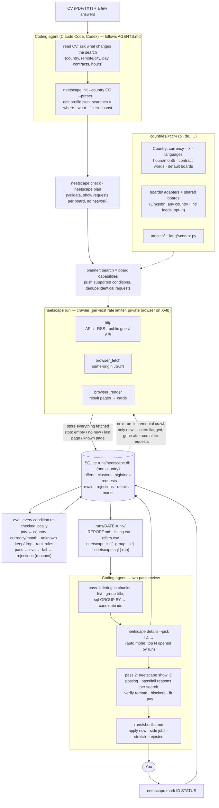

# How it works

[README](../README.md) · [Getting started](getting-started.md) · [Search profile](profile.md) · [How it works](how-it-works.md) · [Boards and countries](boards-and-countries.md) · [Testing](testing.md)

The diagram source is [`docs/flow.mmd`](flow.mmd) (rendered: [`docs/flow.png`](flow.png)).



1. **Plan.** Each board declares capabilities (keyword search, remote filter, city/radius,
   part-time filter, newest-first sort, page size, transport). The planner turns every search
   into requests for every board, pushing only the conditions a board supports, and fetches
   identical requests once. A board that cannot serve a search (e.g. no city search, or a listing
   too large without keywords) is skipped with a warning shown by `neetscape plan`.
2. **Crawl.** Boards run concurrently, requests within a board sequentially, all through a
   per-host rate limiter. Transports: `http` (APIs, RSS), `browser_fetch` (same-origin requests
   from a tab on the board) and `browser_render` (rendered result pages). The browser is a private
   Chromium instance with its own profile on CDP port 9334, on `Xvfb` when available, otherwise
   headless.
3. **Store everything, filter on read.** Every fetched offer is stored. A pushed filter is used
   as evidence (an offer from a remote-filtered request with no mode becomes `remote`), and then
   every condition is re-checked locally, so capabilities affect crawl cost, never results, and a
   profile change does not require a new crawl (`neetscape eval` + `neetscape report`).
4. **Deduplicate.** The same job on several boards forms one cluster (normalised title and
   company); an offer is *new* when its cluster first appeared in this run.
5. **Evaluate.** Every stored offer is checked against every search; passing offers go to `evals`
   with a score, failing ones to `rejections` with the reasons (`mode onsite; title excluded`).
6. **Review in two passes.** Pass 1 reads the listing (in chunks, grouped by title, sliced with SQL)
   and picks candidate ids; `neetscape details --pick` fetches their postings. Pass 2 reads each
   posting with `neetscape show ID` and decides. In `auto` mode `run` already opens the top
   `details_top` postings; in `listing` mode it stops at `listing.tsv`.

Incremental crawling: on boards sorted newest-first a request stops at a full page of offers
already known from earlier runs (`--full` disables this). A request is *complete* when it ends on
an empty, short or no-new-offers page; offers are marked gone only after a complete request with
the same parameters no longer returns them, or when their posting returns 404/410. `run --resume`
continues an interrupted run, skipping requests that already finished.

## Data

Everything lives in `runs/neetscape.db` (SQLite, schema versioned with `PRAGMA user_version`):

| Table | Content |
|---|---|
| `runs` | one row per run: time, status, profile snapshot |
| `requests` | every board request: parameters, pushed conditions, pages, offers found, complete flag, stop reason, error |
| `offers` | one row per board offer: normalised fields, `pay_min`/`pay_max` per month in the profile country's currency, first/last seen run, `gone_at`, `cluster_id` |
| `clusters` | cross-board duplicates; `first_seen_run` drives the *new* flag |
| `sightings` | which request saw which offer on which page |
| `evals` | offers that pass a search in a run, with score, matched rank rules and tags |
| `rejections` | offers that fail a search in a run, with the reasons joined by `; ` (also shown by `neetscape show ID`) |
| `details` | fetched posting text, JSON-LD and hints (remote, years, degree, languages) |
| `marks` | append-only decisions; view `tracked` holds the latest per URL |

Each run also writes `runs/<date>-run<N>/` with `REPORT.md` (board stats, top offers per search,
tracked offers, opened postings), `listing.tsv` and `offers.csv`.

`neetscape list` prints the same listing (one row per job, duplicates across boards merged) with
filters: `--search ID`, `--new`, `--where "o.pay_max > 10000"` (an SQL condition on `offers o`),
`--limit N`, `--format tsv|md|json`. `--group title` collapses it to one row per normalised title
with the number of offers, companies, boards, new offers, best pay and the offer ids:

```
neetscape list --group title --limit 40
neetscape list --search side --new --format md
```

`neetscape sql` opens the database read-only. The parameter `:run` is bound to `--run N` or, by
default, the latest run:

```
# why offers were rejected in this run
neetscape sql "SELECT reasons, COUNT(*) n FROM rejections WHERE run_id = :run GROUP BY 1 ORDER BY n DESC"

# offers passing in the run, per search and board
neetscape sql "SELECT e.search_id, o.board, COUNT(*) FROM evals e JOIN offers o ON o.id = e.offer_id
              WHERE e.run_id = :run GROUP BY 1, 2 ORDER BY 3 DESC"

# board health of the run
neetscape sql "SELECT board, COUNT(*) req, SUM(pages), SUM(found), SUM(complete), SUM(error != '')
              FROM requests WHERE run_id = :run GROUP BY board"

# best-paid remote offers still listed
neetscape sql "SELECT id, title, company, pay_max, url FROM offers
              WHERE mode = 'remote' AND gone_at IS NULL ORDER BY pay_max DESC LIMIT 20"
```
