# How it works

[README](../README.md) · [Getting started](getting-started.md) · [Search profile](profile.md) · [How it works](how-it-works.md) · [Boards and countries](boards-and-countries.md) · [Testing](testing.md)

The diagram source is [`docs/flow.mmd`](flow.mmd) (rendered: [`docs/flow.png`](flow.png)).

```mermaid
flowchart TD
    CV["CV (PDF/TXT) + a few answers"] --> AG
    subgraph AG["Coding agent (Claude Code, Codex) — follows AGENTS.md"]
        A1["read CV, ask what changes the search<br/>(country, remote/city, pay, contracts, hours)"] --> A2["neetscape init --country CC --preset …<br/>edit profile.json: searches = where · what · filters · boost<br/>optional blacklist (companies · urls · text)"]
    end
    A2 --> CHK["neetscape check · neetscape plan<br/>(validate, show requests per board, no network)"]

    subgraph COUNTRY["countries/&lt;cc&gt;/ (pl, de, …)"]
        direction LR
        C1["Country: currency · fx · languages<br/>hours/month · contract words · default boards"]
        C2["boards/ adapters + shared boards<br/>(LinkedIn: any country · intl feeds: opt-in)"]
        C3["presets/ + lang/&lt;code&gt;.py"]
    end
    COUNTRY -.-> PLAN
    CHK --> PLAN["planner: search × board capabilities<br/>push supported conditions, dedupe identical requests"]

    PLAN --> CRAWL
    subgraph CRAWL["stage 1: neetscape run — crawler (per-host rate limiter, board minimum intervals)"]
        direction LR
        HT["http<br/>JSON APIs (GET/POST) · RSS ·<br/>server-rendered pages · guest API"]
        BF["browser_fetch<br/>same-origin fetch in a private tab:<br/>embedded page data (__NEXT_DATA__, …)"]
    end
    CRAWL -->|"store every listing card<br/>stop: empty / short / 404 / no new / known page"| DB[("SQLite runs/neetscape.db (one country)<br/>offers · clusters · sightings · requests<br/>evals · rejections · details · marks")]

    DB --> EVAL["eval: every condition re-checked locally on the cards<br/>pay → country currency/month · unknown keep/drop · blacklist · rank rules<br/>pass → evals · fail → rejections (reasons)"]
    EVAL --> DB
    EVAL --> POST
    subgraph POST["stage 2: postings, only for matches"]
        P1["review.mode auto: top details_top matches<br/>whose job has no stored posting yet<br/>(on demand: details --pick / --top / --marked)"] --> P2["posting text: board API · posting() (JSON-LD / embedded data)<br/>· posting_selector · never the whole page"]
        P2 --> P3["settle unknown mode / work time / contracts<br/>text_exclude + blacklist read the posting · eval again"]
    end
    P3 --> DB
    DB --> OUT["runs/DATE-runN/<br/>REPORT.md · REPORT.html · listing.tsv · offers.csv<br/>neetscape list [--group title] · neetscape sql (:run)"]

    OUT --> REV
    subgraph REV["Coding agent — two-pass review"]
        R1["pass 1: listing in chunks, list --group title,<br/>sql GROUP BY → candidate ids"] --> R2["neetscape details --pick ID,…"]
        R2 --> R3["pass 2: neetscape show ID<br/>posting · pass/fail reasons per search<br/>verify remote · blockers · fit · pay"]
        R3 --> R4["neetscape mark ID shortlisted --note 'why · risk'<br/>neetscape report → REPORT.html review"]
    end
    R2 --> POST
    R4 --> DB
    R4 --> USER(["You"])
    USER --> MARK["neetscape mark ID STATUS"]
    MARK --> DB
    DB -.->|"next run: incremental crawl, only new clusters flagged,<br/>postings opened only for new matches, gone after complete requests"| CRAWL
```



1. **Plan.** Each board declares capabilities (keyword search, remote filter, city/radius,
   part-time filter, newest-first sort, page size, transport). The planner turns every search
   into requests for every board, pushing only the conditions a board supports, and fetches
   identical requests once. A board that cannot serve a search (e.g. no city search, or a listing
   too large without keywords) is skipped with a warning shown by `neetscape plan`.
2. **Crawl the listings (stage 1).** Boards run concurrently, requests within a board sequentially,
   all through a per-host rate limiter. Transports: `http` (JSON APIs over GET or POST, RSS feeds,
   server-rendered result pages) and `browser_fetch` (a same-origin fetch from a tab on the board,
   for boards that only serve a browser; the result is read from data embedded in the page, such
   as `__NEXT_DATA__`). The browser is a private Chromium instance with its own profile on CDP port
   9334, on `Xvfb` when available, otherwise headless.
3. **Store everything, filter on read.** Every fetched listing card is stored. A pushed filter is
   used as evidence (an offer from a remote-filtered request with no mode becomes `remote`), and
   then every condition is re-checked locally, so capabilities affect crawl cost, never results, and
   a profile change does not require a new crawl (`neetscape eval` + `neetscape report`).
4. **Deduplicate.** The same job on several boards forms one cluster (normalised title and
   company); an offer is *new* when its cluster first appeared in this run.
5. **Evaluate.** Every stored offer is checked against every search and the profile's `blacklist`;
   passing offers go to `evals` with a score, failing ones to `rejections` with the reasons
   (`mode onsite; title excluded`).
6. **Fetch postings for matches (stage 2).** See below.
7. **Review in two passes.** Pass 1 reads the listing (in chunks, grouped by title, sliced with SQL)
   and picks candidate ids; `neetscape details --pick` fetches their postings. Pass 2 reads each
   posting with `neetscape show ID` and decides. Decisions are recorded with `neetscape mark`, and
   `REPORT.html` shows them on top of the run's table.

### Postings: the second stage

Listing cards are cheap (dozens of offers per request) but thin: the work mode, work time and
contract are often missing, and the card text is short. Postings are complete but cost one request
each. neetscape therefore filters the cards first and fetches postings only for offers that
already pass:

- In `review.mode: "auto"`, `run` evaluates the cards, then fetches the postings of the top
  `details_top` matches (by the listing order, `min_score` and above) whose job has no stored
  posting yet, and evaluates again. A posting is fetched once per job across runs, so later runs
  only open new matches. In `review.mode: "listing"` the run stops after the first evaluation.
- On demand, `neetscape details` does the same for `--pick ID,...`, `--pick-file F`, `--top N` (the
  top N matches without a stored posting) or `--marked` (offers marked with a status other than
  `rejected`/`ignored` whose posting is not stored yet), then re-evaluates and rewrites the reports.

What a posting changes:

- It settles fields the card left unknown (never overwrites a known one): the work mode only from
  strong signals (JSON-LD `jobLocationType: TELECOMMUTE`, explicit full-remote phrases, hybrid
  words; a posting mentions "remote" for many reasons), the work time and the contract types.
  Company and publication date are filled when the card had none.
- `text_exclude` and the blacklist's `text` patterns also read the posting text.
- So an offer can drop out once its posting is known: `details` logs how many offers no longer
  pass, and `neetscape show ID` prints the reasons.

Where the posting text comes from, first that applies (the source is stored with the posting):
the text the listing already shipped (feeds); a board's JSON posting API or LinkedIn's guest
posting endpoint, over plain HTTP; the offer page fetched in the private browser and read by the
board's posting reader (schema.org `JobPosting` JSON-LD by default, or the board's embedded data);
finally, only for boards that declare a CSS selector for the posting body, that element of the
rendered page. The whole page is never used, so menus, cookie banners and "similar offers" never
reach filters or hints. A 404/410 marks the offer gone; a 401/403/429 answer (a block or login wall) is
stored with its status and the page is not rendered as a fallback.

### Requests, completeness and politeness

Incremental crawling: on boards sorted newest-first a request stops at a full page of offers
already known from earlier runs (`--full` disables this). A request is *complete* when it ends on
an empty, short or no-new-offers page, when the board answers 404 for the page after the last one,
or when the board's single response is its whole listing (feeds, whole-division downloads). Hitting
the page cap (`max_pages`, `--limit-pages`) never counts as the end of a listing. Offers are marked
gone only after a complete request with the same parameters no longer returns them, or when their
posting returns 404/410. `run --resume` continues an interrupted run, skipping requests that
already finished.

Result caps: some boards show at most a fixed number of results per search (olx.pl: 1000), however
many it matches. Such a board declares `result_cap` and reads the match count from the first page
(`total()`). When a request matches more, the crawler asks the board to `split()` it into narrower
requests built from that page (olx.pl: one per subcategory in the page's category tree, read live)
and fetches each to its own end, splitting again if one is still over the cap (up to three levels).
A request that cannot be narrowed is fetched up to the cap and listed under "Capped" in `REPORT.md`,
so missing offers are visible rather than silent. Incremental stops and "gone" marks work per
narrowed request.

Requests to one host are spaced by at least ~1.5 s with jitter, shared by crawling and posting
fetches, with growing back-off on errors (longer on HTTP 429). A board that throttles harder
declares its own minimum interval (theprotocol.it: 4 s); the profile's `politeness.min_interval_s`
(`{"host": seconds}`) overrides both.

## Data

Everything lives in `runs/neetscape.db` (SQLite, schema versioned with `PRAGMA user_version`):

| Table | Content |
|---|---|
| `runs` | one row per run: time, status, profile snapshot |
| `requests` | every board request: parameters, pushed conditions, pages, offers found, complete flag, stop reason, error |
| `offers` | one row per board offer: normalised fields, `pay_min`/`pay_max` per month in the profile country's currency, first/last seen run, `gone_at`, `cluster_id` |
| `clusters` | cross-board duplicates; `first_seen_run` drives the *new* flag |
| `sightings` | which request saw which offer on which page |
| `evals` | offers that pass a search in a run, with score, matched rank rules and tags |
| `rejections` | offers that fail a search in a run, with the reasons joined by `; ` (also shown by `neetscape show ID`) |
| `details` | fetched posting text, HTTP status, posting fields with their `source`, and hints (fully remote, hybrid, years, degree, languages) |
| `marks` | append-only decisions; view `tracked` holds the latest per URL |

Each run also writes `runs/<date>-run<N>/` with `REPORT.md` (board stats, top offers per search,
tracked offers, opened postings), `REPORT.html`, `listing.tsv` and `offers.csv`.

`REPORT.html` is one self-contained page (no external assets) laid out like a mail client: a quiet
list on the left (title, company, pay, age, a work-mode dot, the number of red flags) and the selected
offer on the right: pay next to the title, its facts on one line, the posting's red flags (years of
experience, degree, languages, hybrid wording), the review note (lines starting with ✅ or ⚠ coloured)
and the posting, formatted into headings and lists for reading. Tabs switch between **Review** (every
marked offer, including rejected ones and URLs marked from elsewhere) and **All** (every passing offer).
Everything else sits behind one **View** button: grouping (note category, i.e. the first line of a
multi-line note; status, tag, search, board, work mode), sorting (score, pay, newest, company), filters
(remote only, work mode, board, new, with posting, undecided) and the language (English, Deutsch,
Polski; the default follows the profile's country, `?lang=de` in the URL picks one). Keys: `j`/`k` or
arrows move, `o` opens the offer, `/` searches; `s`/`a`/`r`/`i` decide (shortlisted, applied,
rejected, ignored), `u` undoes, `n` edits the note. Decisions made on the page are kept in the browser
and copied as one block of `neetscape mark` commands (plus `neetscape report`) to paste in a terminal.
`#review` / `#all` in the URL pick the tab. `neetscape report` rewrites the page, e.g. after `neetscape mark`.

`neetscape list` prints the same listing (one row per job, duplicates across boards merged) with
filters: `--search ID`, `--new`, `--where "o.pay_max > 10000"` (an SQL condition on `offers o`),
`--limit N`, `--format tsv|md|json`. `--group title` collapses it to one row per normalised title
with the number of offers, companies, boards, new offers, best pay and the offer ids:

```
neetscape list --group title --limit 40
neetscape list --search side --new --format md
```

`neetscape sql` opens the database read-only. The parameter `:run` is bound to `--run N` or, by
default, the latest run:

```
# why offers were rejected in this run
neetscape sql "SELECT reasons, COUNT(*) n FROM rejections WHERE run_id = :run GROUP BY 1 ORDER BY n DESC"

# offers passing in the run, per search and board
neetscape sql "SELECT e.search_id, o.board, COUNT(*) FROM evals e JOIN offers o ON o.id = e.offer_id
              WHERE e.run_id = :run GROUP BY 1, 2 ORDER BY 3 DESC"

# board health of the run
neetscape sql "SELECT board, COUNT(*) req, SUM(pages), SUM(found), SUM(complete), SUM(error != '')
              FROM requests WHERE run_id = :run GROUP BY board"

# best-paid remote offers still listed
neetscape sql "SELECT id, title, company, pay_max, url FROM offers
              WHERE mode = 'remote' AND gone_at IS NULL ORDER BY pay_max DESC LIMIT 20"
```
